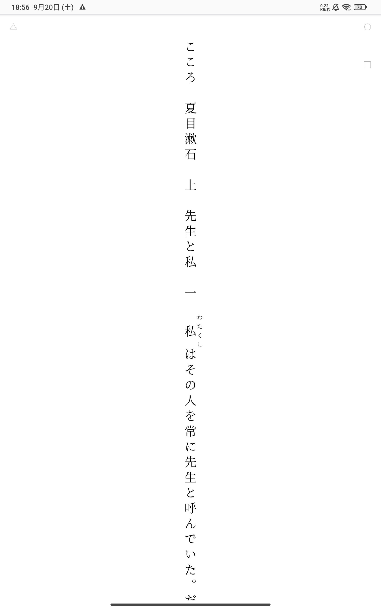
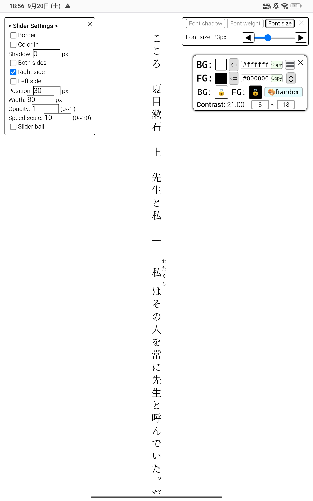
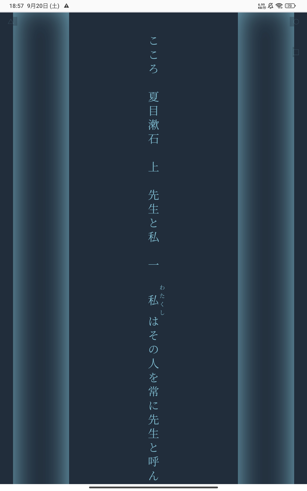
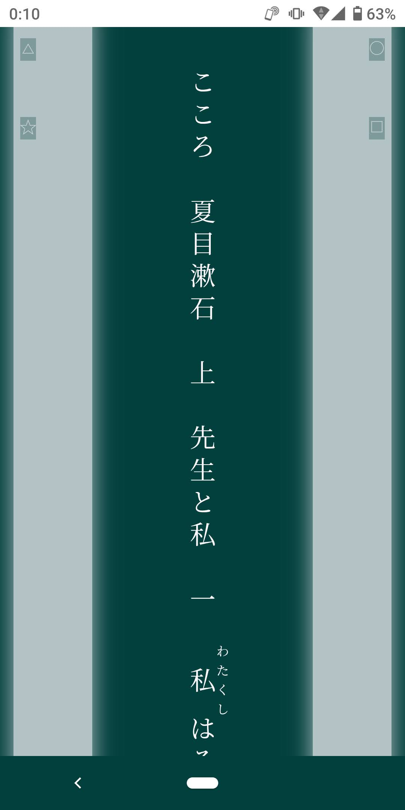

# Web小説一行化ブックマークレット

**とりあえず使ってみたい方は [実行](#実行) を読んでください**

## できること
- Web小説を縦一行に表示し、自動スクロールで読むことができます。
- 文字サイズや色の変更ができます。

> [!WARNING]
> - iOSでは自動スクロールとページ切り替えの挙動がうまくいかず、快適な利用は無理そうでした。
> - 自動スクロールでカクつきが発生する場合は、以下を試してみてください。
>   - Chromeを使う
>   - リフレッシュレートを60Hzにする
>   - `text-shadow`を付けない
>   - 常時自動スクロールスライダーバーに触れる


## 作ったきっかけ
- 「一行を読み終え、次の行を読むときに、読むべき行を見失ってしまう」ことが多く、読書に集中できなかったことがきっかけです。
- 「すべてを一行にしてしまえばいいのでは!?」と思い検索し、みもねる氏の記事｢[青空一行文庫ブックマークレット](https://qiita.com/mimonelu/items/26288a6347e958f500af)｣を見つけました。実際に使ってみて、画面スクロールが大変で読めないなと思ったのが最初で、そこからいろいろな機能を追加していきました。
- AIが書いたコードをコピペ、ツギハギして作りました。私は非エンジニアで、作り始めたころは変数のスコープも理解していませんでした。今も本職の方が見ればおかしなところがたくさんあると思いますが、大目に見てほしいです（コードの改善はしていきたいと思っています）。

## 対応しているサイト
- **青空文庫・小説家になろう・カクヨム・アルファポリス**
- 上記以外のサイトでも使いたい場合や、作者あとがきを含めたくない場合など、自由に改変してください。
  - bookmarklet-main.js 内の`SELECTOR_MAP`によるタグ指定で対応できます。
  - 小説本文のページで右クリックし、「開発者ツール」→「ページのソースを確認」から、縦一行にしたい文章を囲っているタグを確認することができます。

## 実行
- ブックマークレットによる実行です。
  - [index.html ](https://kuansy373.github.io/novel-viewer-bookmarklet/)で一応の説明をしていますが、ブラウザや端末(OS)のバージョンが変わると方法も変わることがあると思います。
<pre><code>javascript:(function(){var s=document.createElement('script');s.src='https://cdn.jsdelivr.net/gh/kuansy373/novel-viewer-bookmarklet@commitHash/src/bookmarklet-main.js';s.onerror=function(){alert('読み込みに失敗しました。\nCDNへの反映が完了していない可能性があります。\nしばらく待ってから再試行してください。');};document.body.appendChild(s)})()
</code></pre>
<br>
最初実行したときは、このような感じです。
<br><br>

<br>
右上、左上にうっすらとある〇や□、△をタップするといろいろ設定できます。
<br><br>

<br>
設定するとこんな感じにできます。左右に伸びてるのは自動スクロールスライダーバーの当たり判定です。<br>
（青タブレット、緑スマホ）
<br><br>
<p align="left">
  
  
</p>

## デフォルト設定 JSON
<details>
<summary>JSONを表示する</summary>

```json
{
  "color": "#000000",
  "backgroundColor": "#ffffff",
  "fontSize": "23px",
  "fontWeight": "400",
  "textShadow": 0,
  "fontFamily": "游明朝",
  "scrollSettings": {
    "right": false,
    "left": false,
    "shadow": 0,
    "opacity": 100,
    "border": true,
    "colorIn": false,
    "position": 10,
    "width": 70,
    "speedScale": 15,
    "showThumb": true
  },
  "searchConfigs": [
    {
      "label": "何者",
      "side": "left",
      "offsetY": 0,
      "query": "何者",
      "engine": "https://www.google.com/search?q="
    },
    {
      "label": "元ネタ",
      "side": "left",
      "offsetY": 40,
      "query": "元ネタ",
      "engine": "https://www.google.com/search?q="
    },
    {
      "label": "日本語訳",
      "side": "left",
      "offsetY": 80,
      "query": "日本語訳",
      "engine": "https://www.google.com/search?q="
    },
    {
      "label": "意味",
      "side": "right",
      "offsetY": 0,
      "query": "とは",
      "engine": "https://www.google.com/search?q="
    },
    {
      "label": "読み方",
      "side": "right",
      "offsetY": 40,
      "query": "読み方",
      "engine": "https://www.google.com/search?q="
    },
    {
      "label": "意味 読み方",
      "side": "right",
      "offsetY": 80,
      "query": "意味 読み方",
      "engine": "https://www.google.com/search?q="
    }
  ]
}
```

</details>

- テキスト選択時の検索ショートカットを非表示にするには、`"searchConfigs": []` と、中身を空にしてください。
- SAVEボタンは、データをどこかストレージに保存しているのではなく、変数に保持しているだけなので、小説タブを閉じると同時に失われます。タブを離れるときには忘れずにコピー、メモするようにしてください。次回以降、入力欄に貼り付けて反映できます。

## 読み込みについて
- ソースコードが長く、モバイル端末ではブックマークのURL欄に入りきらないため、jsDelivr（CDN）での読み込みになっています。
- 読み込むファイルの指定にはコミットハッシュを使用しています。
- ソースコードを確認する際は、`javascript:` コードが指定しているコミットハッシュの bookmarklet-main.js と、 bookmarklet-main.js が`<script src>`で指定しているコミットハッシュの novel-window.js をそれぞれ確認する必要があります。 novel-window.js が指定している pickr.js 、classic.css も同様です。

> [!NOTE]
> - 現在の `javascript:` で読み込まれるもの
>   - bookmarklet-main.js:  [commitHash][hash1]
>   - novel-window.js:  [791ed8ee][hash2]

  [hash1]: https://github.com/kuansy373/novel-viewer-bookmarklet/blob/commitHash/src/bookmarklet-main.js
  [hash2]: https://github.com/kuansy373/novel-viewer-bookmarklet/blob/791ed8ee/src/novel-window.js

## 免責
- 本ツールは現状有姿で提供されます。動作を保証するものではありません。
- 利用によって生じたいかなる損害についても、作者は責任を負いません。
- 対象サイトの仕様変更により、予告なく動作しなくなる可能性があります。
- ご利用は自己責任でお願いします。
